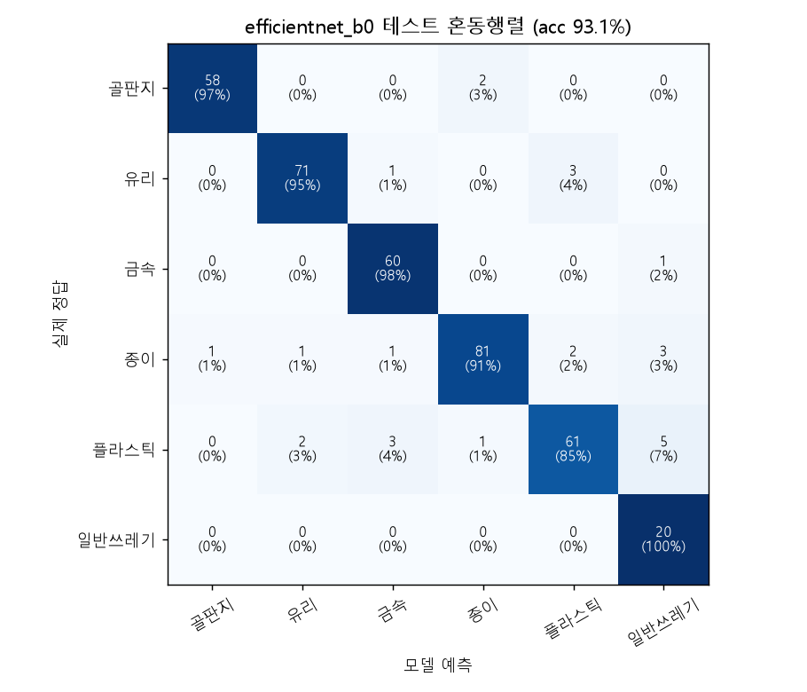
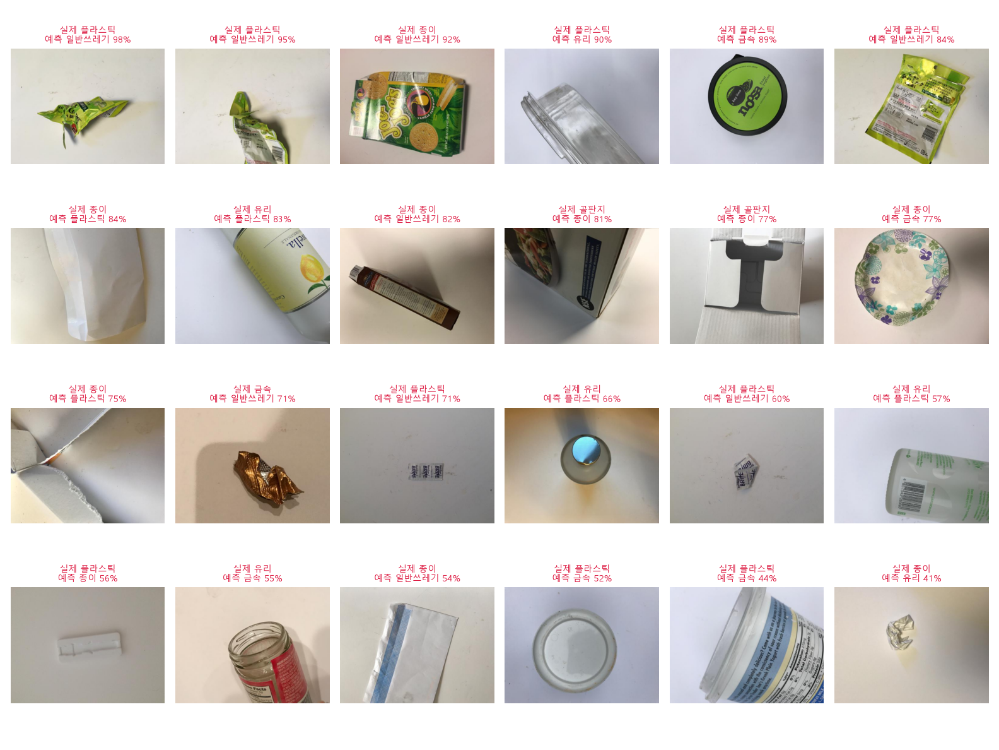

# 쓰레기 분류 (TrashNet 6분류) — 인공지능과 머신러닝 텀프로젝트 ④

사진 한 장을 보고 물체의 재질을 **골판지 / 유리 / 금속 / 종이 / 플라스틱 / 일반쓰레기** 중 하나로 분류합니다.

## 1. 문제와 데이터

| 항목 | 내용 |
|---|---|
| 출처 | TrashNet — https://github.com/garythung/trashnet (`dataset-resized`, 512×384) |
| 사례 단위 | 사진 1장 |
| 입력 | RGB 사진 (224×224로 크기 조정) |
| 정답 | 사진이 들어 있는 폴더 이름 (예: `paper/paper1.jpg` → 종이) |
| 원본 수 | 2,527장 (cardboard 403, glass 501, metal 410, paper 594, plastic 482, trash 137) |
| 결측·중복 처리 | 라벨 오류로 확인된 5장 제외 (`data_split_review/excluded_files.csv`), 같은 물체를 여러 각도로 찍은 사진은 그룹으로 묶음 |

## 2. 자료 분리와 누수 방지

TrashNet에는 **같은 물체를 각도·조명만 바꿔 여러 번 찍은 사진**이 많습니다. 사진 단위로 무작위 분할하면 거의 같은 사진이 학습과 시험에 함께 들어가 정확도가 부풀려집니다.

- 이미지 유사도 후보 + 사람 검토(`pair_review.csv`, `group_edges.csv`, `manual_groups.csv`)로 **같은 물체 그룹**을 만들었습니다.
- 그룹 단위로 train / val / test(약 70/15/15)에 나눴고, **한 그룹은 한 세트에만** 들어갑니다 (`dataset_splits.csv`, `object_groups.csv`).
- 증강(뒤집기·회전·밝기 변경)은 분할 **이후 학습 데이터에만** 실시간 적용합니다.
- 모델 선택(최고 epoch)은 **val**의 macro-F1로만 하고, **test는 마지막에 한 번만** 평가합니다.

| split | 골판지 | 유리 | 금속 | 종이 | 플라스틱 | 일반쓰레기 | 합계 |
|---|---|---|---|---|---|---|---|
| train | 282 | 350 | 286 | 414 | 337 | 96 | 1,765 |
| val | 61 | 75 | 62 | 89 | 72 | 21 | 380 |
| test | 60 | 75 | 61 | 89 | 72 | 20 | 377 |

`python check_split.py` 로 그룹이 세트 사이에 겹치지 않음을 직접 확인할 수 있습니다.

## 3. 결과

모든 결과는 **같은 테스트셋(377장, 학습·모델 선택에 쓰지 않은 물체 그룹)**에서 측정했습니다. GTX 1660 Ti, fp32, seed 42.

| 방법 | 사전학습 | epoch (최고 val) | 테스트 정확도 | 테스트 macro-F1 |
|---|---|---|---|---|
| 기준선: 항상 '종이'라고 답하기 | – | – | 23.6% | 0.064 |
| 작은 CNN (합성곱 4층, 처음부터 학습) | ✗ | 40 (39) | 70.3% | 0.683 |
| ResNet18 (미세조정) | ImageNet | 20 (12) | 90.7% | 0.897 |
| MobileNetV3-Large (미세조정) | ImageNet | 20 (13) | 91.5% | 0.901 |
| ConvNeXt-Tiny (미세조정) | ImageNet | 20 (16) | 92.6% | 0.910 |
| **EfficientNet-B0 (미세조정, 기본 모델)** | ImageNet | 25 (18) | **93.1%** | **0.920** |

클래스 수가 고르지 않아(일반쓰레기 20장 vs 종이 89장) 정확도와 함께 **macro-F1**(클래스별 F1의 평균)을 봅니다. 모델 선택도 val macro-F1 기준입니다.

| 모델 | 파라미터 | 학습 시간 (GTX 1660 Ti) | val macro-F1 |
|---|---|---|---|
| EfficientNet-B0 | 약 400만 | 5.0분 (25 epoch) | 0.913 |
| ConvNeXt-Tiny | 약 2,800만 | 13.0분 (20 epoch, batch 16) | 0.934 |
| MobileNetV3-Large | 약 420만 | 3.3분 | 0.913 |
| ResNet18 | 약 1,100만 | 3.6분 | 0.909 |

> **어떤 모델을 쓸까?** 규칙대로 **val** 기준으로 고르면 ConvNeXt-Tiny가 1등입니다. 테스트에서는 EfficientNet-B0이 2장(0.5%p) 더 맞혔지만, 377장에서 2장 차이는 우연으로도 생길 수 있는 크기입니다. 두 모델 성능은 사실상 같다고 보고, **크기가 1/7이고 2.6배 빨리 학습되는 EfficientNet-B0을 기본 모델**로 정했습니다. 테스트 결과를 보고 모델을 고르면 테스트셋이 더 이상 '보지 않은 자료'가 아니게 되므로, 발표에서는 이 점을 함께 밝힙니다.

### 혼동행렬 (EfficientNet-B0, 행=실제, 열=예측)

| 실제\예측 | 골판지 | 유리 | 금속 | 종이 | 플라스틱 | 일반쓰레기 | 재현율 |
|---|---|---|---|---|---|---|---|
| 골판지 | **58** | 0 | 0 | 2 | 0 | 0 | 96.7% |
| 유리 | 0 | **71** | 1 | 0 | 3 | 0 | 94.7% |
| 금속 | 0 | 0 | **60** | 0 | 0 | 1 | 98.4% |
| 종이 | 1 | 1 | 1 | **81** | 2 | 3 | 91.0% |
| 플라스틱 | 0 | 2 | 3 | 1 | **61** | 5 | 84.7% |
| 일반쓰레기 | 0 | 0 | 0 | 0 | 0 | **20** | 100% |



### 오류 분석



0. **모든 모델에서 플라스틱이 가장 어렵습니다.** 재현율은 ConvNeXt 81.9%, MobileNetV3 83.3%, EfficientNet 84.7%입니다. 일반쓰레기 정밀도는 0.69~0.74로 낮습니다. 일반쓰레기 재현율을 높이려고 클래스 가중치를 줬는데, 그 대가로 다른 재질(특히 비닐 포장)이 일반쓰레기로 끌려옵니다.
1. **플라스틱 오답 사례 (MobileNetV3 기준).** 틀린 플라스틱 사진은 대부분 금속(5)이나 일반쓰레기(4)로 갔습니다.
   - 금속으로 오인: 광택 있는 흰 용기, 반사가 강한 요거트 통. 매끈한 반사광을 금속의 단서로 쓰는 것으로 보입니다.
   - 일반쓰레기로 오인: 구겨진 과자 봉지(비닐 포장재). 이 데이터셋의 'trash' 클래스가 주로 구겨진 비닐·포장재라서 생긴 혼동입니다.
2. **유리 ↔ 플라스틱/금속.** 반투명 젖빛 유리병과 투명 병은 플라스틱 병과 형태가 거의 같습니다. 병 일부만 크게 찍힌 사진은 재질 단서(두께, 굴절)가 적어 더 자주 틀립니다.
3. **종이 ↔ 금속/골판지.** 작게 구겨진 은박 같은 종이는 금속으로, 두꺼운 종이 포장 상자는 골판지로 갔습니다. '종이 상자'의 기준 자체가 애매한 경우입니다(`label_review.csv` 참고).
4. **처음부터 학습한 작은 CNN(70.3%)이 약한 이유: 과소적합.** 학습 정확도도 69%에 머물렀고 40 epoch까지 계속 오르고 있었습니다([학습 곡선](results/simple_cnn/training_curve.png)). 학습 사진 1,765장만으로는 재질 질감 특징을 충분히 배우지 못합니다. 또 클래스 가중치 때문에 일반쓰레기를 과하게 예측합니다(정밀도 0.26). ImageNet으로 미리 학습된 특징을 쓰면 같은 데이터로 +20%p 이상 좋아집니다.
5. **구현 중 발견한 문제: fp16 NaN.** GTX 1660 Ti에서 fp16 혼합정밀도(AMP)를 켜면 일부 사진의 출력이 NaN이 되었습니다. 그 결과 NaN → 0번 클래스(골판지)로 처리되어 일반쓰레기 20장이 전부 골판지로 잘못 집계되었습니다. 지금은 AMP를 기본으로 끄고(`--amp`로만 사용), 테스트 출력에 NaN이 있으면 바로 멈추도록 했습니다.

### 한계와 다음 단계
- TrashNet은 모두 흰 배경·실내 조명 사진입니다. 과제 요구대로 **학습에 없던 물체를 다른 배경에서 찍어** `predict.py --evaluate` 로 따로 시험해야 실제 일반화 성능을 알 수 있습니다.
- 일반쓰레기 테스트 사진이 20장뿐이라 이 클래스의 수치는 오차 범위가 큽니다(1장 = 5%p).

## 4. 재현 방법 (Readme)

```bash
# 1) 코드 받기
git clone <이 저장소 주소>
cd trash-classifier

# 2) 패키지 설치 (GPU가 있으면 https://pytorch.org 에서 CUDA 버전 torch 설치 권장)
pip install -r requirements.txt

# 3) 데이터 준비: 그룹 분할된 TrashNet_dataset 폴더를 저장소 옆(../TrashNet_dataset)에 둔다
#    ../TrashNet_dataset/{train,val,test}/{cardboard,glass,metal,paper,plastic,trash}/*.jpg
#    (다른 위치라면 --data 경로로 지정)

# 4) 분할 점검
python check_split.py --data ../TrashNet_dataset

# 5) 학습 + 기준선 비교 + 테스트 평가 (결과는 results/<모델>/ 에 저장)
python train.py --arch efficientnet_b0 --epochs 25 --lr 1e-3            # 기본 모델
python train.py --arch convnext_tiny   --epochs 20 --lr 1e-4 --batch 16
python train.py --arch resnet18        --epochs 20 --lr 3e-4
python train.py --arch mobilenet_v3    --epochs 20 --lr 5e-4
python train.py --arch simple_cnn      --epochs 40 --lr 3e-3

# 6) 예측 / 추가 시험(학습에 없던 물체를 다른 배경에서 찍은 사진)
python predict.py --model checkpoints/efficientnet_b0.pt --input photo.jpg
python predict.py --model checkpoints/efficientnet_b0.pt --evaluate my_photos/   # my_photos/<클래스>/*.jpg
```

Colab에서 실행할 때는 저장소와 `TrashNet_dataset` 폴더를 올린 뒤 런타임을 GPU로 바꾸고 같은 명령을 `!python ...` 으로 실행하면 됩니다.

## 5. 파일 구성

| 파일 | 역할 |
|---|---|
| `common.py` | 클래스 목록, 데이터셋, 증강, 모델(EfficientNet-B0 / ConvNeXt-Tiny / ResNet18 / MobileNetV3 / 작은 CNN) |
| `train.py` | 학습, 기준선(가장 흔한 클래스) 비교, 테스트 평가, 혼동행렬·오답 이미지 저장 |
| `predict.py` | 사진 예측, 새 사진 폴더로 추가 시험 |
| `check_split.py` | 그룹 누수 점검과 세트별 사례 수 |
| `data_split_review/` | 그룹 분할 근거 CSV (사진별 그룹·세트, 제외 사진, 검토 기록) |
| `results/<모델>/` | `metrics.json`, `confusion_matrix.png/csv`, `training_curve.png`, `test_errors.png/csv` |
